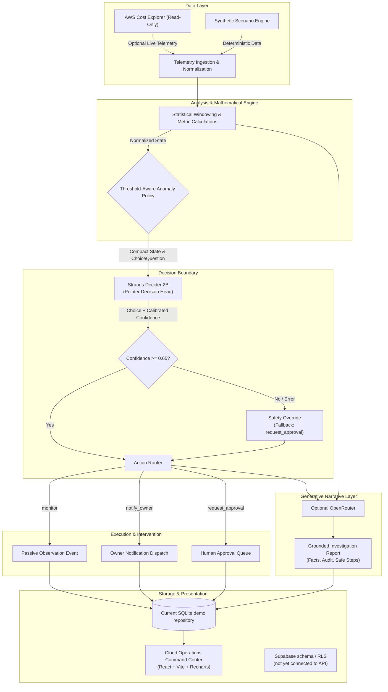

# CloudCost Sentinel — Architecture & System Design

**Tags:** `#strands-decider-2b` `#policy`

**Current runtime note:** The public demo uses synthetic data and a simulated decision provider. Explanations run through a deterministic offline fallback unless backend-only OpenRouter variables are configured. Render demo mode defaults to SQLite under `/tmp`; that data is ephemeral. Supabase schema is under development but the API is not wired to it.

---

## 1. High-Level System Overview

CloudCost Sentinel decouples the **System 1 operational choice** (fast, low-latency pointer decision) from the **generative investigation narrative** (grounded reasoning report).

---

## 2. Component Responsibilities

| Component | Responsibility | Boundary & Constraints |
| :--- | :--- | :--- |
| **Telemetry Ingestion & Formulas** | Computes baseline, delta amount, delta percentage, persistence streak, budget velocity, and data uncertainty. | Deterministic mathematics; no magic thresholds. Excludes recent spikes from baseline to avoid metric pollution. |
| **Strands Decider 2B** | Evaluates normalized state against exact `ChoiceQuestion` (`monitor`, `notify_owner`, `request_approval`). Returns argmax choice and calibrated confidence. | Zero open-ended text generation; strictly evaluates typed options in a single forward pass. |
| **Confidence Guard & Fallback** | Monitors calibrated model confidence against `DECIDER_MIN_CONFIDENCE` (default 0.65). If below threshold or if inference fails, forces `request_approval`. | High-assurance safety mechanism preventing autonomous under-reaction to ambiguous telemetry. |
| **Strands Intervention Handler** | Implements `ThresholdAwareAnomalyIntervention(InterventionHandler)` from the Strands Agents SDK to gate agent tools prior to execution. | Maps `monitor` -> `Proceed`, `notify_owner` -> `Guide`, and `request_approval` -> `Confirm`. |
| **Optional OpenRouter Narrator** | Produces a structured explanation from bounded telemetry. | Backend-only key, explicit model selection, bounded output, strict validation, one transient retry. Deterministic offline fallback is labeled and never overrides the Decider. |
| **Human Review Queue** | Stores pending remediation recommendations for manual engineer sign-off. | Non-mutative sandbox; human approval updates internal audit state without triggering live resource deletions. |
| **Command Center UI** | Dashboard displaying spend curves, Decider choices, wire-level traces, reports, and approval buttons. | React 19 + TypeScript + Vite. Account/workspace frontend and Supabase-backed persistence remain unimplemented. |

---

## 3. Trust Boundaries & AWS Safety Model

1. **Read-Only Telemetry:**
   - AWS Cost Explorer client connects with strictly read-only permissions (`ce:GetCostAndUsage`, `sts:GetCallerIdentity`).
   - Default is `AWS_COST_EXPLORER_ENABLED=false` so the app runs out-of-the-box deterministically.

2. **No Mutative IAM Permissions:**
   - The agent has zero IAM permissions for `ec2:TerminateInstances`, `ec2:ModifyInstanceAttribute`, `autoscaling:UpdateAutoScalingGroup`, or `rds:ModifyDBInstance`.
   - The product's signature is **decision guidance and human approval creation**, not unverified destruction.

3. **Zero Secret Leakage:**
   - No credentials or API keys are ever committed, logged, or returned in HTTP API responses.
